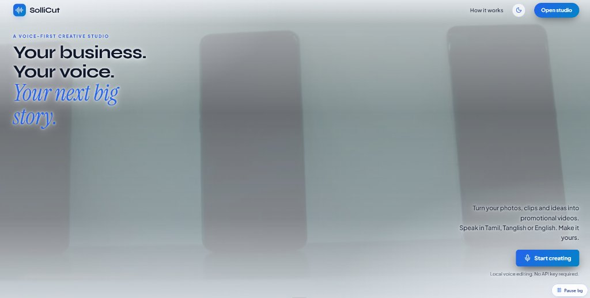
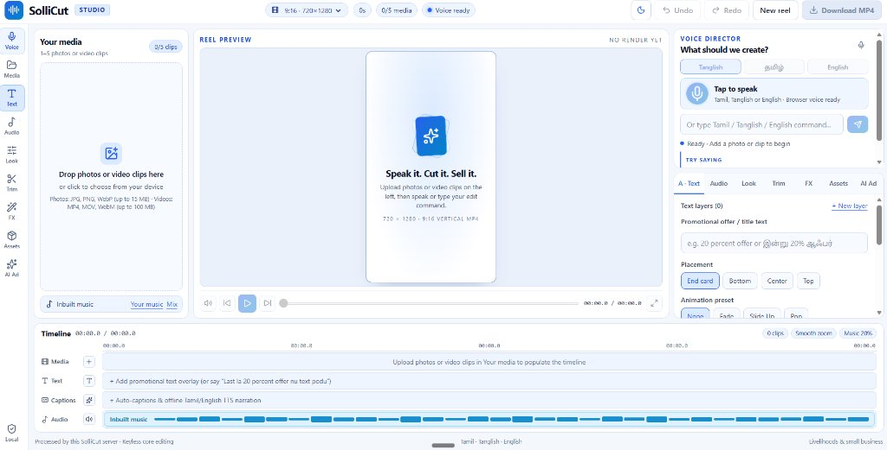

# SolliCut

**Speak it. Cut it. Sell it.** — A voice-first promotional reel studio for small businesses supporting **Tamil, Tanglish, and English**.

- **Live Deployment:** https://sollicut.vercel.app

## Screenshots

### Landing Page


### Studio Workspace


## Quick Start with Docker

Prerequisites: [Docker Desktop](https://www.docker.com/products/docker-desktop/) (with Docker Compose).

```sh
git clone https://github.com/Kanishkar843/sollicut.git
cd sollicut
docker compose up --build
```

Open **http://localhost:8080** in your browser:
- **Landing page:** `http://localhost:8080/`
- **Studio:** `http://localhost:8080/#studio`

No `.env` file or API key is required for core editing, media upload, voice commands, timeline editing, or MP4 export.

> **Optional Cloud AI Ad Generation:** Create a `.env` file at the project root with `GEMINI_API_KEY=your_key` before running `docker compose up --build`.

## Features

- **Landing & Studio Themes:** Campaign lookbook landing page with looping video background and Dark (lime) + Light (white & blue) theme switcher across Landing and Studio.
- **Voice Director:** Speak in Tamil, Tanglish, or English (via local speech models or browser voice recognition) or type commands directly.
- **Multi-Clip Timeline & Inspector:** Upload photos and videos (MP4/MOV/WebM), auto-size duration to your media, trim/split/reorder clips, add text overlays, captions, stickers, transitions, filters, keyframes, voiceover narration, inbuilt soothing music, or your own audio.
- **MP4 Export:** Renders 9:16, 16:9, 1:1, and 4:5 MP4 reels with undo/redo history.

## Verification

```sh
docker compose exec -T sollicut python -m pytest tests/backend -q
```
